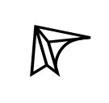

# Selfcrafted Web Application

[](https://github.com/TheAnimatrix/SCWeb/actions/workflows/deploy.yml)
[](https://selfcrafted.in)



## Overview

The code behind [selfcrafted.in](https://selfcrafted.in), a marketplace where independent hardware makers in India sell finished products, spares and surplus parts, plus a service for getting a model 3D printed by a maker who owns a printer. SvelteKit front end, Hono API in `api/`.

## Getting Started

### Prerequisites

- Node.js (v16 or higher)
- npm (v8 or higher)

### Installation

1. Clone the repository:

   ```bash
   git clone https://github.com/TheAnimatrix/SCWeb.git
   cd SCWeb
   ```

2. Install dependencies:

   ```bash
   npm install
   ```

3. Set up environment variables:

   - Create a `.env` file in the root directory.
   - Add your Supabase URL and public API key:

     ```
     VITE_SUPABASE_URL=your-supabase-url
     VITE_SUPABASE_ANON_KEY=your-supabase-anon-key
     ```

4. Start the development server:

   ```bash
   npm run dev
   ```

5. Open your browser and navigate to `http://localhost:5173` to view the application.

## Blog content

The blog lives at `/blog`, with individual posts at `/blog/[slug]`. Posts are entries in
`src/lib/blog/posts.ts`: a stable slug, title, excerpt, category, the date it first went live, an
optional cover image with alt text and credit, and body blocks (paragraphs, headings, lists, and quotes
with an attribution). Paragraphs can carry links. Reading time is calculated from the text and the
sitemap picks posts up automatically. Write from first-hand experience and name real products and pages;
the comment at the top of `posts.ts` has the rules.

Blog illustrations are stored in `static/images/blog`; the generation prompts are recorded in
`docs/blog-image-prompts.md`.

## Contributing

Contributions are welcome! Please follow these guidelines:

1. Fork the repository.
2. Create a new branch for your feature or bug fix.
3. Make your changes and commit them with descriptive messages.
4. Push your changes to your forked repository.
5. Submit a pull request to the main repository.

## License

This project uses a **dual-license** model:

- **Default:** [GNU Affero General Public License v3.0](LICENSE) (AGPL-3.0) — free to use, with copyleft obligations including the network/SaaS clause for modified hosted deployments.
- **Commercial:** Required for closed-source/non-copyleft use or commercial use expecting gross revenue over USD $10,000.

See [LICENSING.md](LICENSING.md) for the full explanation. Contributors accept [CLA.md](CLA.md) so contributions may be distributed under both licenses.

Commercial licensing: **creo@selfcrafted.in**

---
